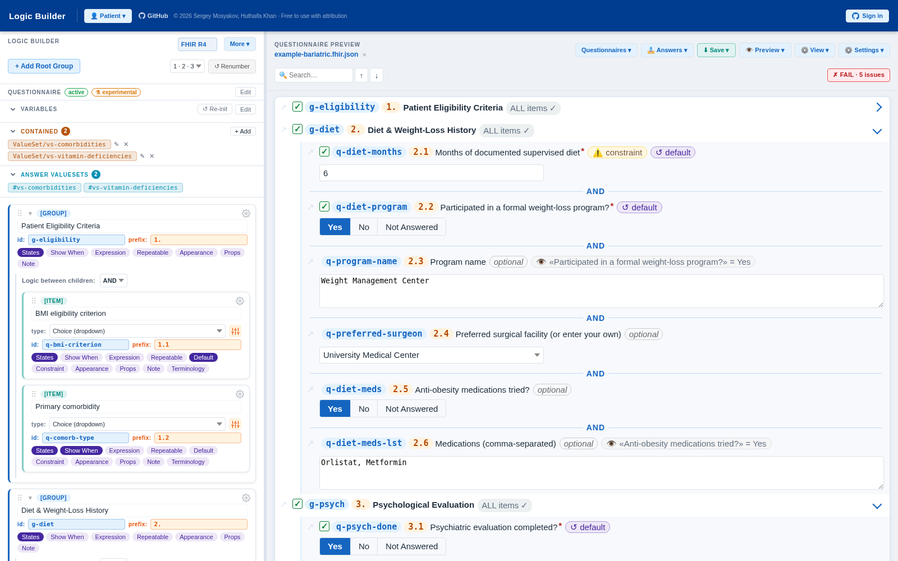
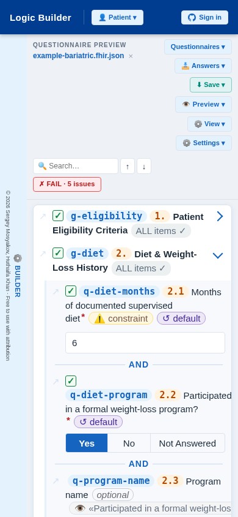
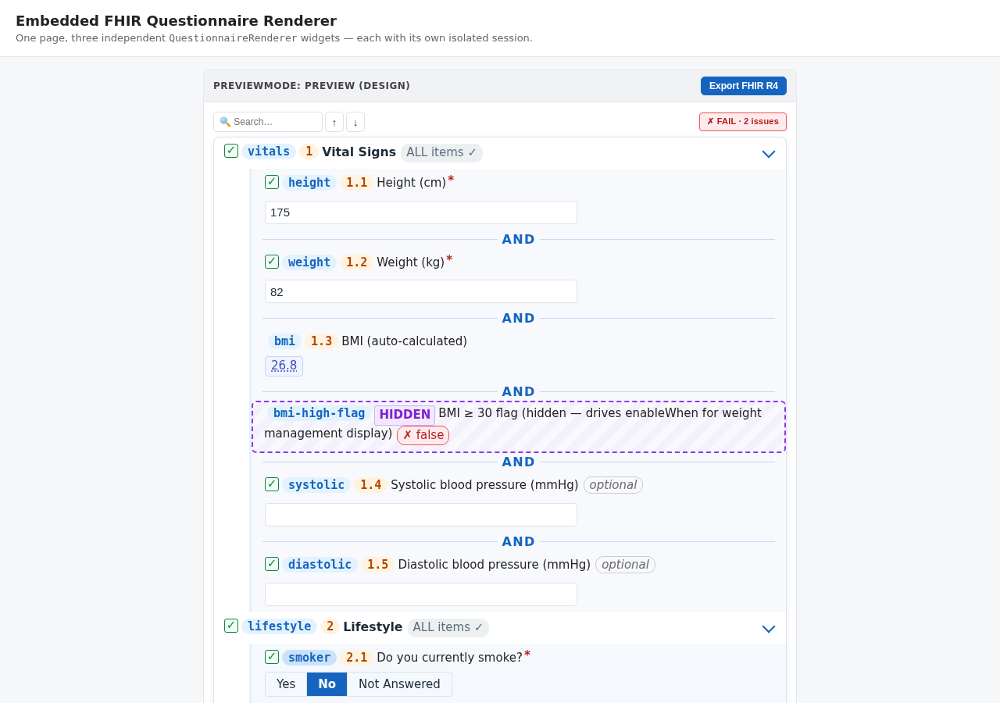

# QuestionaryPrototype — FHIR Questionnaire Builder

A prototype **visual logic builder** for medical prior authorization questionnaires based on [FHIR R4 / R4B / R5 Questionnaire](https://hl7.org/fhir/R4/questionnaire.html).

Lets you build questionnaire logic visually, test it against patient data, and import/export FHIR R4/R4B/R5 JSON or REDCap CSV, or generate a draft questionnaire from a FHIR StructureDefinition/profile. The target version is set from a dropdown in the builder toolbar; version is auto-detected on import from `meta.fhirVersion`.

The right-side **preview panel is a live SDC-compliant runtime**: it executes FHIRPath expressions, resolves `enableWhen` / `enableWhenExpression`, evaluates `calculatedExpression` and `initialExpression` chains against an injected Patient resource, and produces a valid `QuestionnaireResponse`. Import an existing QR to resume a partially-filled session. The builder and the runtime are always in sync — edits to item logic are immediately reflected in the live form.

> © 2026 [Sergey Mosyakov](https://github.com/sergeymosyakov) / [Roko Labs Inc.](https://www.rokolabs.com) — Non-commercial use with attribution. Commercial use requires prior written permission.

<p align="center">
  
</p>
<p align="center"><sub>Desktop — Logic Builder (left) + live SDC Questionnaire Preview (right)</sub></p>
<p align="center">
  
</p>
<p align="center"><sub>Mobile — responsive layout, collapsible Builder rail</sub></p>

---

## 📦 Embed the renderer as a widget

The right-side runtime ships as a standalone, embeddable **`QuestionnaireRenderer`**
widget — drop a FHIR R4 `Questionnaire` into any web page and get a live, fillable
form that runs the SDC logic and returns a `QuestionnaireResponse`. No builder
shell, no iframe, no framework.

<p align="center">
  
</p>
<p align="center"><sub>The embeddable widget — same live SDC runtime, no builder shell</sub></p>

```html
<link rel="stylesheet" href="questionnaire-widget.css">
<div id="form"></div>
<script type="module">
  import { QuestionnaireRenderer } from './questionnaire-widget.js';
  const questionnaire = await (await fetch('my-questionnaire.json')).json();
  const widget = new QuestionnaireRenderer(document.getElementById('form'), {
    questionnaire, config: { previewMode: 'patient', validation: true },
  });
  document.querySelector('#save').onclick = () => save(widget.getResponse());
</script>
```

- **Full guide & API reference:** [WIDGET.md](WIDGET.md)
- **Use via CDN (no install):** `https://cdn.jsdelivr.net/gh/sergeymosyakov/fhir-questionnaire-builder@widget-v1.0.17/dist/questionnaire-widget.js` (+ `.css`)
- **Download the bundle:** [GitHub Releases](https://github.com/sergeymosyakov/fhir-questionnaire-builder/releases)
- **Live demo:** [fhirbuilder.com/widget-demo.html](https://fhirbuilder.com/widget-demo.html) — three isolated widgets + a custom “Export FHIR R4” button

---

## Documentation

| Doc | Contents |
|---|---|
| [WIDGET.md](WIDGET.md) | **Embeddable renderer widget** — install, config, API, events, examples |
| [docs/CONTEXT.md](docs/CONTEXT.md) | Architecture, file map, node model, UX features, build rules |
| [docs/FHIR-MAPPING.md](docs/FHIR-MAPPING.md) | FHIR R4 field mapping, supported extensions, known gaps |
| [docs/EXPRESSION-GALLERY.md](docs/EXPRESSION-GALLERY.md) | Catalog of the ready-made FHIRPath calculation patterns (BMI, eGFR, GCS, due date, ...) with inputs and sources; also published as [gallery.html](https://fhirbuilder.com/gallery.html) |

| [templates/](templates/) | Ready-made questionnaire templates (PHQ-9, GAD-7, AUDIT-C, ...) with LOINC codes and automatic scoring — one FHIR Questionnaire per template; catalog in `templates/library.json`, also published as [templates.html](https://fhirbuilder.com/templates.html) |
| [Issues labeled `roadmap`](https://github.com/sergeymosyakov/fhir-questionnaire-builder/issues?q=is%3Aissue+is%3Aopen+label%3Aroadmap) | Feature backlog |
| [docs/COMPETITORS.md](docs/COMPETITORS.md) | Honest, no-spin comparison vs LHC-Forms, Smart Forms, Aidbox, Medplum, Firely |

---

## Running

> **Requires an HTTP server** — ES modules do not work over `file://`.

### Locally
```powershell
.\start.ps1
# or: npx serve .
# open http://localhost:3000
```

### GitHub Pages
https://fhirbuilder.com/

### Tests
```powershell
npm test             # unit tests — single run (Vitest)
npm run test:watch   # unit tests — watch mode
npm run test:e2e     # e2e tests — Playwright/Chromium
npm run test:e2e:ui  # e2e tests — Playwright UI mode
```
Vitest and Playwright CI run automatically on every push via GitHub Actions.
Playwright HTML report: https://fhirbuilder.com/playwright-report/
Coverage report: https://fhirbuilder.com/coverage/

> **One-time setup**: in the repo go to **Settings → Pages → Source** and select **GitHub Actions**.

---

## Sample Questionnaires

All samples live in `sampledata/` and are listed in `sampledata/library.json`. Load them from the **Questionnaires ▾ → From Library…** menu (questionnaires, other formats such as REDCap CSV and StructureDefinition, and a few sample responses under **Answers ▾ → From Library…**). A selection:

| File | What to look for |
|---|---|
| `example-bariatric.fhir.json` | Default on startup. BMI calc, radio, attachment, open-choice, `contained[]` ValueSets, constraints. |
| `bariatric-extended.fhir.json` | Stress-test: all item types, many `enableWhen`, nested sub-sections. |
| `phq-9.fhir.json` | Minimal scoring questionnaire — fast baseline test. |
| `annual-health-check.fhir.json` | Full-feature reference: prefix, LOINC codes, sliders, ordinalValue, repeats, rendering-style, BMI calc, constraint. |
| `valueset-demo.fhir.json` | Contained ValueSets, local `#vs-id` refs, external URL, rendering-style. |
| `sdc-variables-demo.fhir.json` | SDC questionnaire-level variables + `calculatedExpression`. |
| `patient-scenario-*.fhir.json` | Load + select a patient preset + Re-init to test `initialExpression` / `enableWhenExpression`. |
| `redcap-clinical-demo.fhir.json` | Converted from a REDCap Data Dictionary, including branching logic and calculations. |
| `sd-demo-patient.json` | A FHIR **StructureDefinition** (not a Questionnaire) — pick "Generate draft" to build a Questionnaire from it. |
| `r4b-demo.fhir.json`, `r5-demo.fhir.json` | R4B / R5 documents. |

## Tech Stack

- **ES Modules** — `import/export` between files; requires HTTP server; no build step, no bundler
- **Vanilla JS DOM** — builder and preview rendered imperatively via OOP node classes; state propagated through `AppEvents` custom events
- **FHIRPath** — `lib/fhirpath.min.js` (global); powers calc, visibility, and constraint expressions
- **DOMPurify** — `lib/dompurify.min.js`; sanitizes XHTML content before rendering
- **marked** — `lib/marked.min.js`; renders markdown in display-item content
- **fhir-structuremap-js** — `lib/fhir-structuremap-js.esm.js`; executes FHIR StructureMap transforms for SDC populate/extract (author's own library)
- **cql-execution / cql-exec-fhir** — `lib/cql-execution.esm.js`, `lib/cql-exec-fhir.esm.js`; CQL/ELM execution engine + FHIR data source, powers `initialExpression` CQL evaluation
- **Supabase** — `lib/supabase.min.js`; auth + optional cloud sync backend
- **Vitest** — unit tests; CI via GitHub Actions (`npm test`)
- **Playwright** — e2e tests (Chromium); CI + HTML report on GitHub Pages

---

## Third-party content notices

This project includes sample questionnaire files that contain LOINC-coded content.

This material contains content from LOINC (http://loinc.org). LOINC is copyright © Regenstrief Institute, Inc. and the Logical Observation Identifiers Names and Codes (LOINC) Committee and is available at no cost under the license at http://loinc.org/license. LOINC® is a registered United States trademark of Regenstrief Institute, Inc.

The builder's code search feature retrieves SNOMED CT concepts via the public FHIR terminology server (tx.fhir.org). SNOMED CT® is a registered trademark of SNOMED International. Use of SNOMED CT content is subject to the [SNOMED CT Affiliate License](https://www.snomed.org/get-snomed). Use in SNOMED International member countries is free; use in non-member countries may require a fee. This application does not distribute or embed SNOMED CT content — codes are fetched live from a licensed FHIR terminology server at the user's request.

ICD-10-CM codes are retrieved via the NLM Clinical Tables API (https://clinicaltables.nlm.nih.gov/). ICD-10-CM is maintained by the U.S. Centers for Disease Control and Prevention (CDC) and is in the public domain.

The NLM Clinical Tables Search Service is provided free of charge by the U.S. National Library of Medicine. Neither NLM, LHNCBC, NIH, nor any contributor's name may be used to endorse products derived from this service without prior written permission.

The ready-made questionnaire templates in `templates/` (PHQ-9, PHQ-2, GAD-7, GAD-2, AUDIT-C) use the published scale wording and LOINC codes and answer lists (see the LOINC notice above). PHQ-9, PHQ-2, GAD-7 and GAD-2: developed by Drs. Robert L. Spitzer, Janet B.W. Williams, Kurt Kroenke and colleagues, with an educational grant from Pfizer Inc.; no permission required to reproduce, translate, display or distribute ([phqscreeners.com](https://www.phqscreeners.com/)). AUDIT-C: derived from the WHO AUDIT (Bush et al., Arch Intern Med 1998;158:1789); the ONC USCDI/ISP listing for AUDIT-C (submitted by NIAAA) states no restrictions on use ([isp.healthit.gov](https://isp.healthit.gov/uscdi-data/audit-c)). The intake fragments (demographics, allergies, medications, pain) are original wording written for this builder and covered by the project license (see `LICENSE`). Each template's source and license are also shown in the template picker.

Sample files sourced from HL7 Implementation Guides are published under Creative Commons Attribution 4.0 (CC BY 4.0). Source URLs are preserved in each file's `url` field.

### Vendored JavaScript libraries

`lib/cql-execution.esm.js` and `lib/cql-exec-fhir.esm.js` are built from [cql-execution](https://www.npmjs.com/package/cql-execution) and [cql-exec-fhir](https://www.npmjs.com/package/cql-exec-fhir), both licensed under the [Apache License 2.0](https://www.apache.org/licenses/LICENSE-2.0).

`lib/supabase.min.js` is built from [@supabase/supabase-js](https://www.npmjs.com/package/@supabase/supabase-js), licensed under the [MIT License](https://opensource.org/licenses/MIT).

### WHO SMART Guidelines performance-test fixture

`sampledata/who-emcare-treatment.fhir.json` is a copy of `questionnaire-emcare.treatment.json`, retrieved on 2026-08-11 from the World Health Organization SMART Guidelines "EmCare" (IMCI) repository at [github.com/WorldHealthOrganization/smart-emcare-cmr](https://github.com/WorldHealthOrganization/smart-emcare-cmr) (`input/resources/questionnaire/`). We include it **solely as a performance-regression test fixture** (a genuinely large, real-world ~226-item questionnaire); it is **not** registered in the sample library (`sampledata/library.json`) and is not presented as an example.

We are making this provenance explicit in the interest of transparency and good faith:

- **License status:** at the time of retrieval the upstream repository contained **no `LICENSE` file**. WHO SMART Guidelines content is generally published under [CC BY-NC-SA 3.0 IGO](https://creativecommons.org/licenses/by-nc-sa/3.0/igo/). This project itself is licensed for **non-commercial use with attribution** (see `LICENSE`), which is consistent with those terms.
- **No ownership claim / no endorsement:** all rights in this content remain with the World Health Organization. WHO does not endorse this project.
- **Takedown commitment:** if you are a rights holder (or represent one) and object to its inclusion for any reason, please [open an issue](https://github.com/sergeymosyakov/fhir-questionnaire-builder/issues) or contact the maintainer, and we will **remove the file promptly, no questions asked**.

The file's own `copyright` field records the same source and intent.

---

## Feedback welcome

I built this to solve a real problem — we needed to edit FHIR R4 Questionnaires without a full EHR stack.
Not sure if others have the same need. If you've stumbled on this:

- Does the UX make sense for your workflow?
- Are there FHIR fields you'd expect that are missing?
- Any opinion on offline ValueSet resolution?

Open an issue or drop a comment — even a "this isn't useful because X" is helpful.
